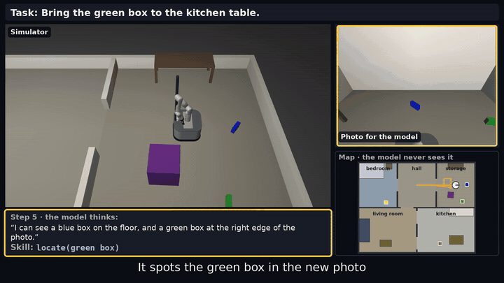

# VLM interactive fetch

**Status:** Finished for now (2026-11-15). A research project; not maintained.

[](media/116_demo.mp4)

*Click the preview for the full demo video (150 s, `media/116_demo.mp4`).*

## Goal
Can an off-the-shelf vision-language model run a household fetch robot in simulation, choosing among scripted skills
from camera photos and object names alone? The robot must fetch a named box to a named surface, push a blocker out of a
doorway or go round one that does not move, and handle two boxes in one request. It is measured on a sealed test it
never saw. And does the model add anything over a fixed script?

## Result in short
- **Base sealed test (house A):** 86 of 100 tasks.
- **A second, new house (E2):** 86 of 100.
- **Without the task generator's easings (E1):** 77 of 100. All 16 tasks whose box the arm cannot reach from anywhere
  failed.
- **A fixed script (E3b)** scored 88 vs the model's 86 in house A, the house it was written for, but 70 in house B.
- **Tasks that need judgement (E4):**
  - When the box is named by its place ("the box on the nightstand"), the model adds value: 31 vs 1 of 34.
  - When the box is moved mid-task, the model does worse: 0 vs 8 of 33.
  - So by the rule fixed before the run, there is **no clear overall value** over the best script.

Every table, with 95 % ranges: [RESULTS.md](RESULTS.md). Every rule change, with its date and the result it came before:
[DEVIATIONS.md](DEVIATIONS.md). Per-task outcomes and skill-call sequences: [results/](results/).

## How it works
A Stanford TidyBot (from MuJoCo Menagerie, plus a mast camera) works in a generated five-room MuJoCo house. Each step,
the model (Qwen3.8-27B, served by vLLM, used as is with no fine-tuning) gets:
- the task text;
- the latest camera photos;
- the names of the places and objects;
- its own past calls and their text results.

It answers with one skill call. The skills are scripted. Boxes are located with the depth camera; the model never
outputs a metric pose. A harness checks each call, runs it, and stops at 20 steps. A scorer then judges the final
simulator state.

Each test is 100 tasks drawn by seed and hashed before any run (`tasksets/sealed/`). It is run once, with the agent
frozen.

Skills: `navigate(place, via)` · `look()` · `locate(object)` · `pick(object)` · `place(surface)` · `push(object)` ·
`done(note)`.

Code: `agent/` (prompt, tools, harness, scorer, fixed-script baselines E3a / E3b / E3c), `sim/` (robot, house generator,
skills, perception, task generator, analysis and clip scripts), `hpc/` (cluster batch scripts and the container
recipe), `tests/`.

## What it does not claim
- A real robot.
- Houses beyond these two.
- Firm per-type rates: there are 25 tasks per type, so the intervals are wide.
- Results repeatable run for run: the model samples, while the scripts are deterministic.
- Fully perceived scenes. Some things still come from the simulator:
  - the crate and cabinet positions;
  - place's landing check;
  - push's knowledge of nearby boxes;
  - the grip check.
- Noise-free depth. Depth is exact, with no noise model.

## Reproduce
Linux (tested on Ubuntu 24.04) with [uv](https://docs.astral.sh/uv/) and Python 3.12. The scripted baselines and the
tests need no model server and no data-centre GPU. They were run on a laptop GPU (RTX 4060) with headless EGL
rendering (`MUJOCO_GL=egl`). CPU-only rendering (OSMesa) was not tested.

```bash
git clone https://github.com/matus012/vlm-interactive-fetch && cd vlm-interactive-fetch
uv sync
# robot model: MuJoCo Menagerie at the pinned revision (sparse, ~100 MB instead of the full 2.6 GB)
git clone --filter=blob:none --no-checkout https://github.com/google-deepmind/mujoco_menagerie ext/mujoco_menagerie
git -C ext/mujoco_menagerie sparse-checkout set stanford_tidybot hello_robot_stretch_3
git -C ext/mujoco_menagerie checkout 370c43965323c0944b433b202aac5058b5f907a9
MUJOCO_GL=egl uv run pytest -q
# one fixed-script (E3b) run on a development task in house A, scored at the end
MUJOCO_GL=egl PYTHONPATH=. uv run python -m sim.agent_run --taskset tasksets/phase4_fetch_tuning.json \
    --task-id fetch-8001 --out runs/demo --script e3b
```

The sealed tests were drawn and run on an NVIDIA renderer (EGL); task generation depends on rendered pixel counts, so
regenerate a sealed list on NVIDIA.

**VLM runs** need an OpenAI-compatible vLLM server with Qwen3.8-27B (one H200 was used):
`python -m sim.agent_run ... --base-url http://127.0.0.1:<port>/v1`. The `hpc/*.sbatch` files are the batch jobs that
ran the sealed tests on a SLURM cluster with Apptainer. They are examples; to use them on your own cluster, set:
- `PERUN_ACCOUNT` (submit with `sbatch -A "$PERUN_ACCOUNT"`);
- `PROJECT_DIR` (the project folder on the cluster);
- `IMAGE_DIR` (where `g1.sif` / `vllm.sif` live);
- `MODEL_DIR` (the Qwen3.8-27B weights);
- `PERUN_LOGIN` (the login node, for `hpc/sync_code.sh`).

To re-run a sealed test, point `NAV116_SEALED_DIR` at `tasksets/sealed/` (the default). Check the hashes with
`sha256sum -c tasksets/sealed/SHA256SUMS`. House B: `NAV116_HOUSE=B`.

## Licences / clean-room
Public code and public models only. Code: MIT ([LICENSE](LICENSE)). Robot model, simulator, VLM and server licences:
[THIRD_PARTY.md](THIRD_PARTY.md).

## Author
Matúš Filo, BSc student, Intelligent Systems, Technical University of Košice (FEI TUKE), 2026. Compute: TUKE PERUN
cluster (H200), 7.0 GPU-hours in total.
